# Architecture

Aaj Kya Pakayen is an **offline-first** Flutter app built with feature-first Clean Architecture.
Everything runs on-device against a local SQLite database. The suggestion engine is plain Dart,
so a cloud sync backend can be added later without touching the UI or the engine.

## Layers

```mermaid
flowchart TD
  UI["features/* (widgets, Riverpod providers)"] --> UC["domain/usecases"]
  UI --> ENT["domain/entities + enums"]
  UC --> ENG["domain/engine (SuggestionEngine, rules, scoring)"]
  UC --> REPO["domain/repositories (interfaces)"]
  IMPL["data/repositories_impl"] -.implements.-> REPO
  IMPL --> DB["data/db (Drift tables, DAOs, migrations)"]
  IMPL --> SEED["data/seed"]
  CORE["core/* (theme, l10n, router, widgets)"] --> UI
```



| Layer | May import | Must not import |
| --- | --- | --- |
| `domain/` | Dart SDK, small pure-Dart packages (`freezed_annotation`, `meta`, `collection`) | `flutter`, `drift`, `data/`, `features/`, `core/` |
| `data/` | `domain/`, `drift`, platform packages | `features/` |
| `features/` | `domain/`, `core/`, Riverpod providers that expose repositories | `data/db/` (DAOs/tables) |
| `core/` | Flutter, `domain/` enums for theming badges | `data/`, `features/` |

These rules are enforced by `test/architecture/layering_test.dart`.

## Folder layout

```
lib/
  main.dart / app.dart
  core/       theme/, l10n/, router/, utils/, constants/, widgets/
  data/       db/ (Drift tables, DAOs, migrations), seed/, repositories_impl/
  domain/     entities/, enums/, repositories/, engine/ (rules/, scoring/), usecases/
  features/   today/, pantry/, history/, dishes/, settings/
test/         mirrors lib/, plus engine/ property-style tests and architecture/
docs/         this file, DATABASE.md, BRANDING.md, GIT_WORKFLOW.md, DECISIONS.md
```

## State management and navigation

- **Riverpod** (`flutter_riverpod` + `riverpod_generator`). Repositories are exposed as providers in
  `data/`. Overriding them in `ProviderScope` swaps in fakes for tests.
- **go_router**. Routes are defined in `core/router/app_router.dart` and the router is provided by
  Riverpod, so redirects (e.g. onboarding) can read app state.

## Suggestion engine (overview)

`SuggestionEngine` is a pure function of a `SuggestionContext`:
dishes, the dinner log, pantry batches, settings, today's date, any day-type override,
and an "another" counter. It has no I/O.

1. **Hard filters:** active dishes from enabled cuisines, the no-repeat window, the day type,
   protein in stock (scaled by household size), and staple pairing.
2. **Soft scoring:** use the oldest protein first, avoid the same protein as last time,
   avoid the same cooking style as yesterday, and fit the time budget.
3. **Seeded tie-break:** the seed is derived from the date and the "another" counter.
4. **Output:** the top 3 `Suggestion`s, each with an optional side and `ReasonCode`s.
   The UI localizes the reasons.

Full details arrive with `feature/suggestion-engine`.

## Sync plan (not built yet)

`domain/repositories/sync_repository.dart` will define:

```dart
abstract interface class SyncRepository {
  Future<void> push();          // upload local changes since last sync
  Future<void> pull();          // fetch remote changes and merge
  Stream<SyncStatus> watchStatus();
}
```

v1 ships a `NoopSyncRepository`. A future Supabase or Firebase adapter will live in
`data/repositories_impl/` and plug in like this:

- Every synced table gets `updated_at` and a client-generated UUID, so records merge without
  ID clashes.
- Conflicts resolve last-write-wins per row. `dinner_log` is unique per date.
- Pantry quantities are rebuilt from `pantry_movements` (an append-only event log), so
  concurrent edits merge cleanly.
- Sync is triggered on app resume and after each write, debounced.

No UI or engine code changes are needed to turn it on.
