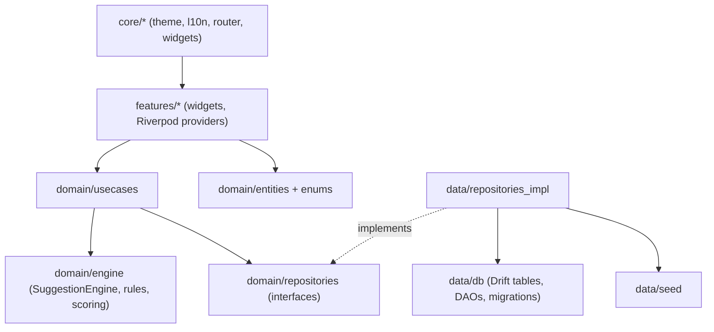
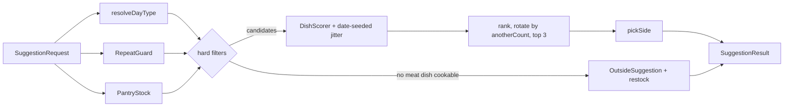

# Architecture

Aaj Kya Pakayen is an **offline-first** Flutter app built with feature-first Clean Architecture.
Everything runs on-device against a local SQLite database. The suggestion engine is plain Dart,
so a cloud sync backend can be added later without touching the UI or the engine.

## Layers



| Layer | May import | Must not import |
| --- | --- | --- |
| `domain/` | Dart SDK, small pure-Dart packages (`freezed_annotation`, `meta`, `collection`) | `flutter`, `drift`, `data/`, `features/`, `core/` |
| `data/` | `domain/`, `drift`, platform packages | `features/` |
| `features/` | `domain/`, `core/`, Riverpod providers that expose repositories | `data/db/` (DAOs/tables) |
| `core/` | Flutter, `domain/` enums for theming badges | `data/`, `features/` |

These rules are enforced by `test/architecture/layering_test.dart`.

## Folder layout

```
lib/
  main.dart / app.dart
  core/       theme/, l10n/, router/, utils/, constants/, widgets/
  data/       db/ (Drift tables, DAOs, migrations), seed/, repositories_impl/
  domain/     entities/, enums/, repositories/, engine/ (rules/, scoring/), usecases/
  features/   today/, pantry/, history/, dishes/, settings/
test/         mirrors lib/, plus engine/ property-style tests and architecture/
docs/         this file, DATABASE.md, BRANDING.md, GIT_WORKFLOW.md, DECISIONS.md
```

## State management and navigation

- **Riverpod** (`flutter_riverpod` + `riverpod_generator`). Repositories are exposed as providers in
  `data/`. Overriding them in `ProviderScope` swaps in fakes for tests.
- **go_router**. Routes are defined in `core/router/app_router.dart` and the router is provided by
  Riverpod, so redirects (e.g. onboarding) can read app state.

## Suggestion engine

The engine lives in `lib/domain/engine/`. `SuggestionEngine.suggest(SuggestionRequest)` is a pure, deterministic
function. Its inputs are the date, dishes, pairings, dinner log, pantry batches, settings and the
"another" counter. The use case `GetTonightSuggestions` (`domain/usecases/`) loads those inputs from the
repositories. It loads the log for the last max(window, 30) days, plus the latest entry for the flip.



### Hard rules (`engine/rules/`)

| Rule | Where | Behaviour |
| --- | --- | --- |
| Alternation and swap | `day_type_rule.dart` | Tonight is the flip of the latest dinner before tonight, or veg day if there is none. A `DayTypeOverride` applies to its own date only, and tomorrow flips from what was logged. Outside dinners count as non-veg. |
| No repeats | `repeat_guard.dart` | A dish is blocked if it or its `variantGroup` was a main or a side within `repeatWindowDays`. "Within" means `daysAgo < window`. |
| Pantry | `pantry_stock.dart` | A meat dish needs `grams/person × household` of its protein, summed over batches. |
| Pairing | `side_picker.dart` | Only meat mains get a side: the best-priority curated pairing that is an active, allowed vegetable side. At most one. |
| Outside | `suggestion_engine.dart` | Available on every non-veg day (`canOrderOutside`). It becomes the only suggestion when no meat dish is cookable, with `restock` set to the proteins that would unblock dishes. |
| Cuisine and active | `suggestion_engine.dart` | Only active dishes from `enabledCuisines` are considered. |

### Soft scoring (`engine/scoring/`)

Weights live in `weights.dart`.

| Signal | Effect | Reason code |
| --- | --- | --- |
| Oldest batch of the dish's protein | +2 per day, capped at 14 days | `proteinInStock` (from 2 days) |
| Same protein as the last non-veg dinner | −15 | `differentProtein` when it differs |
| Same cooking style as yesterday | −10 | |
| Style not cooked in the window (not `other`) | +3 | `freshStyle` ("No karahi this week") |
| Time budget (quick ≤30, normal ≤60) | +5 if it fits, −8 if not; none for elaborate | `fitsTime` |
| Days since last cooked | +0.2 per day, capped at 30 (never cooked counts as 30) | `notCookedFor` (from 14 days) |
| Pulse dish | | `servedWith` (rice, roti or either) |
| Seeded jitter | +0 to 4, `Random(yyyymmdd × 31)` | |

"Show me another" rotates the ranked list by `anotherCount`, so each tap brings the next-best dish to
the top and the list wraps around. The domain layer holds no user-facing strings: `Reason` is a sealed
union that the UI localizes.

### Tests

- `test/engine/`: one file per rule, the scorer, engine scenarios.
- `engine_properties_test.dart`: 20 simulated households cook for 60 days from the real seed catalogue. Every day it checks alternation, no repeats, pantry cover, side rules and determinism.

## Sync plan (not built yet)

`domain/repositories/sync_repository.dart` defines:

```dart
abstract interface class SyncRepository {
  Future<void> push();          // upload local changes since last sync
  Future<void> pull();          // fetch remote changes and merge
  Stream<SyncStatus> watchStatus();
}
```

v1 ships a `NoopSyncRepository`. A future Supabase or Firebase adapter will live in
`data/repositories_impl/` and plug in like this:

- Every synced table gets `updated_at` and a client-generated UUID, so records merge without
  ID clashes.
- Conflicts resolve last-write-wins per row. `dinner_log` is unique per date.
- Pantry quantities are rebuilt from `pantry_movements` (an append-only event log), so
  concurrent edits merge cleanly.
- Sync is triggered on app resume and after each write, debounced.

No UI or engine code changes are needed to turn it on.
