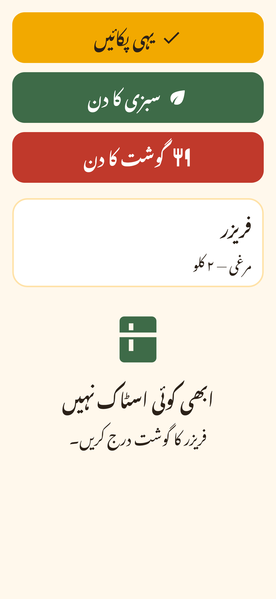

# Branding

**Name:** Aaj Kya Pakayen — آج کیا پکائیں؟ ("What shall we cook today?")
**Tagline:** "Dinner, decided." — "رات کا کھانا، طے!"

## Palette

| Token | Hex | Use |
| --- | --- | --- |
| Turmeric | `#F2A900` | Primary |
| Cardamom | `#3E6B48` | Veg / secondary |
| Chilli | `#C0392B` | Meat / accent |
| Cream | `#FFF8EC` | Background |
| Chai Brown | `#2B2118` | Text |
| Saffron tint | `#FFE2A8` | Surface highlight |

## Typography

- Latin: Poppins (headings) and Nunito (body). Urdu: Noto Nastaliq Urdu.
- Fonts are bundled as assets, not fetched at runtime (see DECISIONS D-004).
- Body text is at least 18sp. Nastaliq needs a taller line height (≈1.8).

## Shape and iconography

- Material 3, rounded 20dp cards, soft shadows.
- The logo is a simple pot/karahi mark, kept in `assets/brand/` as SVG.
- Launcher icons are generated with `flutter_launcher_icons`, splash screens with `flutter_native_splash`.

## Voice

Warm, brief and respectful, with no jargon. For example: "Aaj sabzi ka din hai."

## Implementation

| What | Where |
| --- | --- |
| Colour tokens | `lib/core/theme/app_colors.dart` (`AppColors`) |
| Theme | `lib/core/theme/app_theme.dart`: `AppTheme.light(urdu:)` and `AppFonts` |
| Fonts and licences | `assets/fonts/` and `assets/fonts/licenses/` (all SIL OFL 1.1) |
| Logo | `assets/brand/logo.svg`; rasters: `icon.png`, `icon_foreground.png`, `splash.png` |
| Shared widgets | `lib/core/widgets/` (`BigButton`, `SectionCard`, `EmptyState`, `AppLogo`, `showUndoSnackBar`) |
| Strings | `lib/core/l10n/arb/app_{en,ur}.arb` |

### Type scale

All sizes are in sp. The smallest size anywhere is 18.

| Role | Size |
| --- | --- |
| Display | 32–40 |
| Headline | 24–30 |
| Title | 20–24 |
| Body | 18–20 |
| Label | 18–20 |

Line height is 1.9 for Urdu and 1.3 for English.

### Colour roles

| Token | Role | Text on it |
| --- | --- | --- |
| Turmeric | Primary buttons | Chai Brown |
| Cardamom | Veg tone | White |
| Chilli | Meat tone | White |

All three pairs pass the Flutter `textContrastGuideline`.

### Regenerating icons and splash

```bash
rsvg-convert -w 1024 -h 1024 assets/brand/logo.svg -o assets/brand/icon.png
dart run flutter_launcher_icons
dart run flutter_native_splash:create
```


