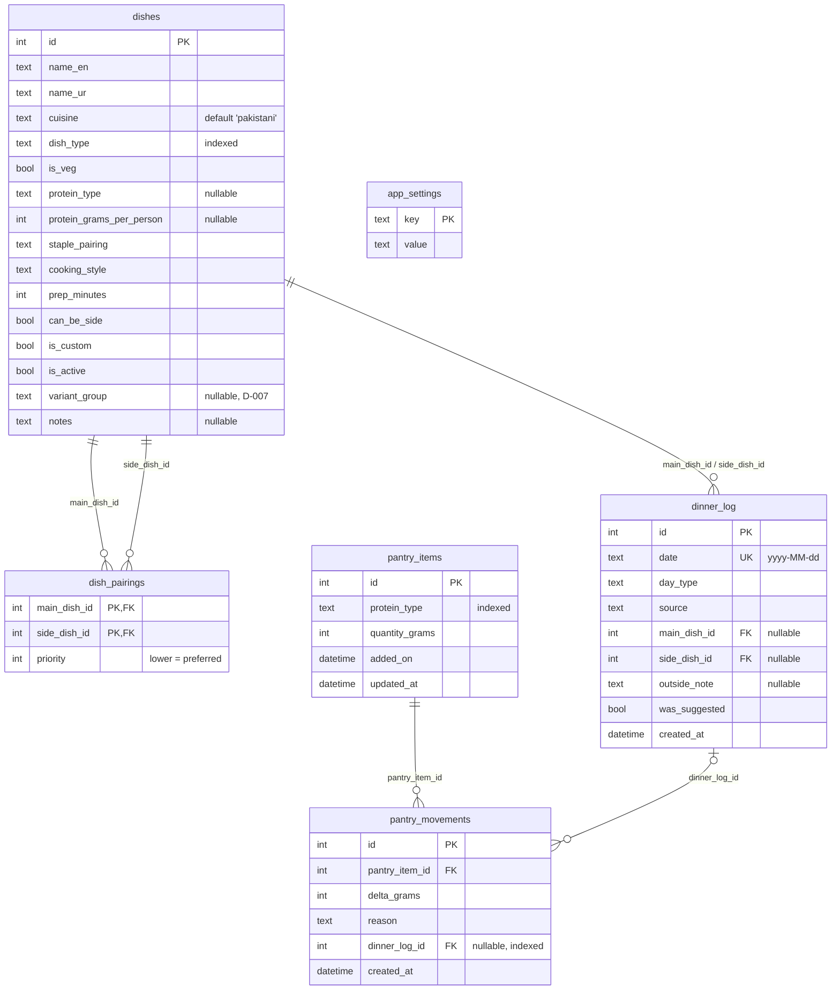

# Database

Local SQLite via [Drift](https://drift.simonbinder.eu/). Schema version **1**.

- Tables: `lib/data/db/tables.dart`
- Database: `lib/data/db/app_database.dart`
- DAOs: `lib/data/db/daos/`
- Repositories (domain-typed): `lib/data/repositories_impl/`, exposed by `lib/data/providers.dart`

Seed data: `lib/data/seed/` (see [Seed data](#seed-data)).

## ER diagram

## Storage conventions

- **Enums** are stored by their Dart name. The brief's upper-case names map like this:

  | Brief | Stored |
  | --- | --- |
  | `VEG_DAY` | `vegDay` |
  | `NON_VEG_DAY` | `nonVegDay` |
  | `RICE_DISH` | `riceDish` |
  | `VEGETABLE` | `vegetable` |
  | `CHICKEN` | `chicken` |

  The rest follow the same pattern.
- **`dinner_log.date`** is `yyyy-MM-dd` text with a `UNIQUE` constraint. That gives one dinner per calendar day and the index the brief asks for. Saving a second entry for a date replaces the first and keeps its id.
- **`dishes.is_veg` and `protein_type`** are written from `dish_type`, so they never disagree with it.
- **Foreign keys** are switched on at open:
  - Deleting a dish removes its pairings.
  - Deleting a dinner sets `pantry_movements.dinner_log_id` to null.
  - Dishes are deactivated (`is_active`), never deleted, so history keeps its references.
- **Pantry:**
  - Each purchase is a new `pantry_items` row with a `purchase` movement.
  - Every change goes through `PantryRepository.applyMovement`, which updates the batch and appends the movement in one transaction. It refuses to go below zero.
  - Batches with 0 g are kept for the ledger but hidden from stock lists.
- **Settings** are one readable row per key:

  | Key | Example |
  | --- | --- |
  | `household_size` | `4` |
  | `repeat_window_days` | `7` |
  | `language` | `ur` |
  | `enabled_cuisines` | `pakistani` (comma-separated) |
  | `reminder_enabled` | `false` |
  | `reminder_time` | `16:30` |
  | `time_budget` | `normal` |
  | `day_type_override` | `2026-10-15:nonVegDay` |
  | `onboarding_complete` | `false` |

  Unreadable values fall back to defaults.

## Indexes

| Index | Columns |
| --- | --- |
| `idx_dishes_dish_type` | `dishes(dish_type)` |
| `idx_pantry_items_protein_type` | `pantry_items(protein_type)` |
| `idx_pantry_movements_dinner_log` | `pantry_movements(dinner_log_id)`, used by undo |
| *(unique autoindex)* | `dinner_log(date)` |

## Migrations

1. Change the tables and bump `schemaVersion`.
2. Run `dart run drift_dev make-migrations`. It dumps `drift_schemas/app_database/drift_schema_vN.json` and regenerates `test/data/db/migrations/generated/`. Commit both.
3. Add the step to `migration` in `AppDatabase`.
4. `test/data/db/migrations/migration_test.dart` checks:
   - that the code schema matches the latest dump
   - every upgrade path between dumped versions

## Seed data

`lib/data/seed/pakistani_dishes.dart` holds 78 dishes and 19 curated pairings.

| Type | Ids | Count | Examples |
| --- | --- | --- | --- |
| Vegetable | 1–29 | 23 | Aloo Gobi, Bhindi Masala, Baingan Bharta, Sarson ka Saag |
| Pulse | 30–49 | 16 | Daal Chawal, Daal Mash Tarka, Rajma Chawal, Kadhi Chawal |
| Chicken | 50–69 | 14 | Chicken Karahi, White Karahi, Qorma, Biryani, Aloo Chicken Salan |
| Beef | 70–79 | 9 | Nihari, Haleem, Paye, Aloo Gosht, Daal Gosht |
| Mutton | 80–89 | 6 | Mutton Karahi, Shinwari Karahi, Namkeen Gosht |
| Mince | 90–99 | 10 | Aloo Qeema, Shami Kebab, Seekh Kebab, Chapli Kebab |

- **Ids are permanent,** because history rows point at them. Custom dishes start at `10000`.
- **Variant groups** count as one dish for the no-repeat rule:

  | Group | Dishes |
  | --- | --- |
  | `chicken_karahi` | karahi, white karahi |
  | `mash_daal` | mash ki daal, daal mash tarka |
  | `lobia` | lobia chawal, lobia masala |
  | `mutton_karahi` | mutton karahi, shinwari karahi |

- **Pairings** always join a meat main with a vegetable dish that can be a side.
- **Protein grams per person** are raw meat per adult serving. They are lower for dishes bulked out with potatoes, peas or daal.

### Seeding

`DishSeeder` runs at startup through `appStartupProvider`, behind the native splash:

- It writes the catalogue when the stored `app_settings.seed_version` is below `seedVersion`. Otherwise it does nothing.
- Re-seeding after a bump refreshes built-in dishes but keeps `is_active` as the family set it, and never touches custom dishes.
- To change the catalogue, edit the list, bump `seedVersion`, and keep `test/data/seed/` green.
